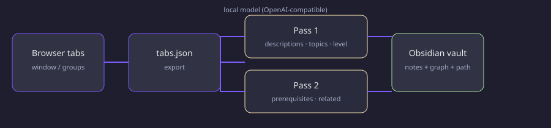

# sortME

> Turn a browser full of LLM tabs into an Obsidian knowledge graph with a
> reading path — using your own local model.



You collect dozens of papers and blog posts, never get around to reading them,
and lose the thread. This project exports those tabs, asks a local LLM to
describe and relate them, and writes an Obsidian vault where every note has:

- a **long English description** (problem → method → takeaway),
- **topic nodes** that form a subject graph,
- **prerequisite and related links to other notes** — the relationship graph,
- a **status** you can change from the Properties panel or with one-click buttons,
- and several **learning paths** derived from that graph.

No cloud APIs, no Python dependencies, no account. Just `python3`, a local
GGUF model served by `llama-server` (or Ollama / vLLM / LM Studio), and Obsidian.

---

## Quick start

```bash
git clone https://github.com/J-RAY3E/sortME.git sortME
cd sortME
chmod +x start-local-model.sh run.sh

cp config.example.json config.json          # set your vault path
./start-local-model.sh                      # terminal 1: local model

# terminal 2: export tabs with the extension, then
./run.sh tabs-2026-11-21.json all           # import + open Obsidian
```

Full guide: **[docs/QUICKSTART.md](docs/QUICKSTART.md)**

## What lands in your vault

| File | Purpose |
|---|---|
| `Fuentes/` | One note per tab: description, topics, level, status, prerequisites, related notes, read-time estimate |
| `Temas/` | Topic nodes (Dataview queries) |
| `00-Status.md` | Queue by status — **plain Markdown, no plugin needed** |
| `00-Dashboard.md` | Same queue with Dataview (if the plugin works) |
| `00-Graph Overview.md` | Graph organised into topic clusters (Mermaid) |
| `00-Learning Path.md` | Ordered reading sequence + Mermaid graph |
| `00-Foundational Notes.md` | The 10 notes that unlock the most other material |
| `Paths/To *.md` | Personalised prerequisite chains toward the top target notes |
| `00-Knowledge Map.canvas` | Visual canvas of the whole graph, positioned by level |
| `00-Queue Kanban.kanban` | Drag-and-drop queue (obsidian-kanban plugin) |
| `00-Daily Queue Snippet.md` | Block to paste into your daily note |
| `references.bib` | BibTeX entries for the papers |
| `MOC-LLMs.md` | Master index |

---

## Feature list

### AI pipeline
- **Two passes** — pass 1 writes descriptions/topics/level; pass 2 infers
  prerequisite and related edges between *all* notes.
- **Structured descriptions** — the model answers `problem`, `method`,
  `takeaway` separately; the script joins them into ~90 words of English.
- **Confidence per relation** — low-confidence edges can be filtered out.
- **Model skills** — Markdown rule files injected into the system prompt.
- **Presets** `fast | balanced | deep` and a layered config file.
- **Response cache** — identical prompts never hit the model twice.
- **Incremental import** — only new or changed sources are processed.
- **Content ingestion** — `--fetch-content` downloads pages/PDFs and feeds
  real text to the model (uses `pdftotext` when available).
- **Semantic deduplication** — near-identical titles are grouped (mirrors of
  the same paper), not duplicated.
- **JSON-mode / GBNF grammar** — optional stricter decoding for unreliable models.

### Graph & paths
- Directed prerequisite graph with deterministic topological ordering.
- Foundational-note ranking by in-degree.
- Per-target paths (`Paths/`) built by reverse traversal.
- Obsidian Canvas export with level-based layout.
- Mermaid dependency diagram in the learning path.

### Obsidian UX
- One-click status buttons embedded in every note (DataviewJS).
- Kanban board backed by the same notes.
- Local favicons (`--favicons`).
- Daily-note snippet.

### Automation & integrations
- Browser extension: current window, **multiple tab groups**, one file per
  group, dedupe, skip internal pages, copy JSON or Markdown.
- `feed` — pull recent arXiv papers into a tabs file.
- `zotero` — export items from the local Zotero API.
- `readwise` — export articles via the Readwise API.
- `watch` — watch an inbox folder and import automatically; systemd unit included.
- `search` — TF-IDF or embedding-based search over your notes.
- `ask` — RAG: answer a question citing your own notes.

### Quality & publishing
- `doctor` — environment health check.
- `eval` — compare notes against a labelled set.
- Offline test suite with a mock model + GitHub Actions workflow.
- MIT license, `pyproject.toml`, `.gitignore`.

**Full reference: [docs/ADVANCED.md](docs/ADVANCED.md)**

---

## Commands at a glance

```bash
# import
python3 tabs_to_obsidian.py import tabs.json --vault /path/to/vault --llm
python3 tabs_to_obsidian.py import tabs.json --vault ... --llm --preset deep \
    --fetch-content --dedupe --favicons

# rebuild only one stage
python3 tabs_to_obsidian.py import tabs.json --vault ... --llm --descriptions-only
python3 tabs_to_obsidian.py import tabs.json --vault ... --llm --relations-only

# maintenance
python3 tabs_to_obsidian.py doctor --vault /path/to/vault
python3 tabs_to_obsidian.py clear-cache        # or: import --clear-cache
python3 tabs_to_obsidian.py search "attention" --vault /path/to/vault
python3 tabs_to_obsidian.py search "attention" --vault ... --embeddings
python3 tabs_to_obsidian.py ask "What is RAG?" --vault /path/to/vault
python3 tabs_to_obsidian.py eval --vault /path/to/vault --labels eval/labels.json
python3 tabs_to_obsidian.py validate --vault /path/to/vault --dry-run
python3 tabs_to_obsidian.py validate --vault /path/to/vault
python3 tabs_to_obsidian.py refresh-ux --vault /path/to/vault

# feeders / automation
python3 tabs_to_obsidian.py feed --query "LLM agents" --output arxiv-tabs.json
python3 tabs_to_obsidian.py zotero --output zotero-tabs.json
python3 tabs_to_obsidian.py readwise --token $READWISE_TOKEN --output rw.json
python3 tabs_to_obsidian.py watch --dir Inbox --interval 30 --llm

# orchestrator
./run.sh tabs.json all|full|fast|deep|descriptions|relations|serve|open
```

## Documentation

- [Quick start](docs/QUICKSTART.md)
- [Configuration & presets](docs/CONFIGURATION.md)
- [Model skills](docs/SKILLS.md)
- [Architecture](docs/ARCHITECTURE.md)
- [Advanced features](docs/ADVANCED.md)
- [Troubleshooting](docs/TROUBLESHOOTING.md)

## Notes on the model

Default: `qwen2.5-coder-7b-instruct-q4_k_m.gguf` on `http://127.0.0.1:8080`.
Needs ~5 GB RAM; a cold 72-source import takes 20–30 min on CPU. With the
cache and incremental import, subsequent runs are seconds. Point `--llm-url`
at any OpenAI-compatible endpoint to use another model.

## License

MIT — see [LICENSE](LICENSE).
